<div align="center">

<picture>
  <source media="(prefers-color-scheme: dark)" srcset="assets/readme/wordmark-dark.svg">
  
</picture>

**The desktop that's on your side.**

A keyboard-first desktop for Linux, in one download that installs beside the one you have.

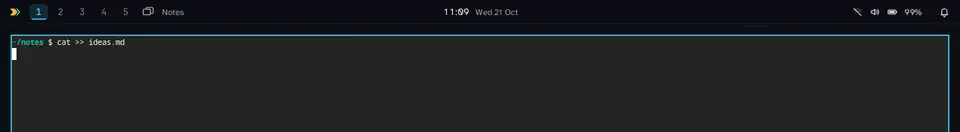

<sub>Three messages arrive while you type. Nothing pops up until you pause.</sub>

[](https://github.com/peterwalker78/slipstream-desktop/actions/workflows/ci.yml)
[](https://github.com/peterwalker78/slipstream-desktop/releases)
[](LICENSE)

[**Get it**](#get-slipstream) · [**Questions**](#questions) · [**Every key**](guide/keys.md) · [**Help**](guide/help.md)

</div>

Most of the screens in your life are built to keep you checking, scrolling and coming back. Slipstream is built to give that time back. It holds your notifications until you pause, shows you what's going on without asking for a look, and measures nothing about you. It's somewhere to sit down and make things, and easy to get up from when you're done.

Two companion apps share that aim. [Glimmerwood](https://github.com/peterwalker78/glimmerwood) is a quiet browser whose small wisp brightens when you read, learn or make something, and grows sleepy in an endless feed. [Westering](https://github.com/peterwalker78/westering) is for the end of the day: a few quiet minutes under tonight's real sky, and then it suggests you go and look at the real stars, or go to bed.

Nothing here stops you scrolling a feed. It's just much less fun than what Slipstream is built for.

And along the way, it turns out to be quite something to look at.

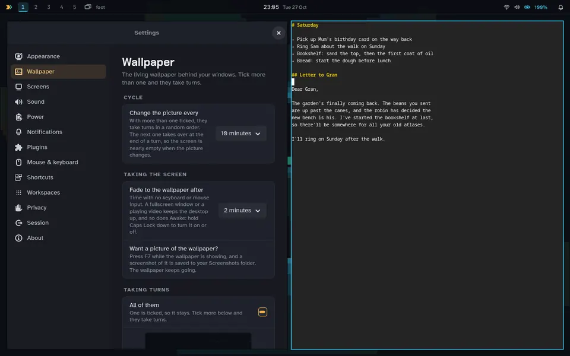

<sub>Step away and your windows sink into a living wallpaper; one key brings them back. Recorded from Slipstream itself.</sub>

## Nothing interrupts you

You know the moment: halfway through a thought, something pops up, and the thought is gone. Slipstream can tell that you're typing - never what - and keeps that moment yours.

- **Notifications wait for a pause,** then arrive together as one card. Urgent ones never wait, and nothing waits more than 15 minutes.
- **Windows you didn't ask for can't barge in** or run off with your keyboard. They pour into a stream at the edge of the screen instead, with a quiet toast to say so.
- **Hold Caps Lock for Awake,** and the desktop won't fade or lock by itself until you hold it again. A quick press still turns capitals on and off.

## What you put away keeps you posted

<table align="right">
<tr>
<td align="center">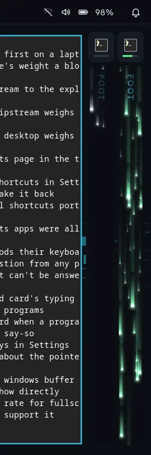<br><sub>Slipstream</sub></td>
<td align="center">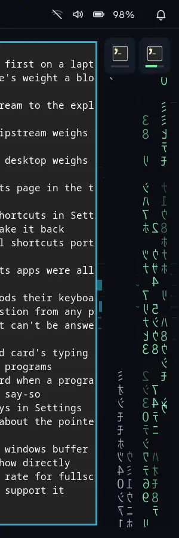<br><sub>Code rain</sub></td>
</tr>
</table>

Put a window away and it pours down the side of the screen as a stream of light, and keeps running there.

**The stream is a readout.** A busy app pours fast and bright, a quiet one sends a few slow grey streaks, so a build finishing catches your eye without you going to look.

**Rest the pointer on a stream for the numbers behind it.** A small card names the app and what it's using right now: its memory, its share of the processor, and what it's downloading and uploading, with its helper processes counted in. Click the stream to bring the window back.

Prefer the film's code rain? Settings → Appearance → Effects swaps the light for falling green code, each stream spelling out its app's name.

<br clear="right">

**Closing, too.** A closed window drops while a shower of streaks eats it away from the top, with the scanlines and flicker of a failing CRT.

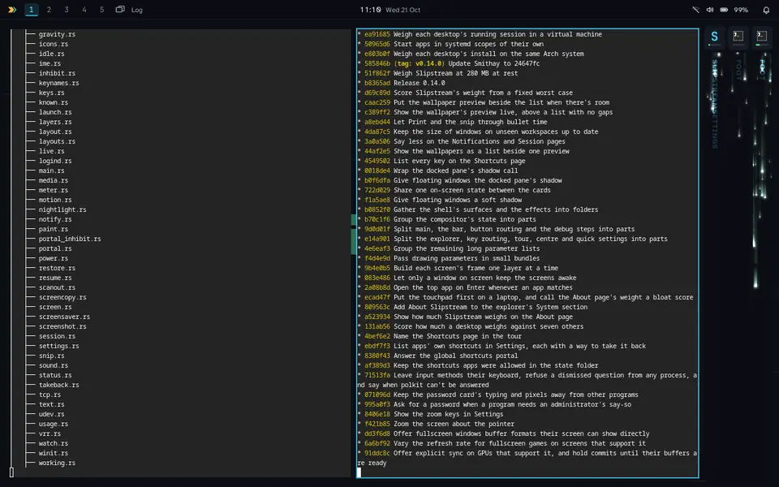

## Every window, one key away

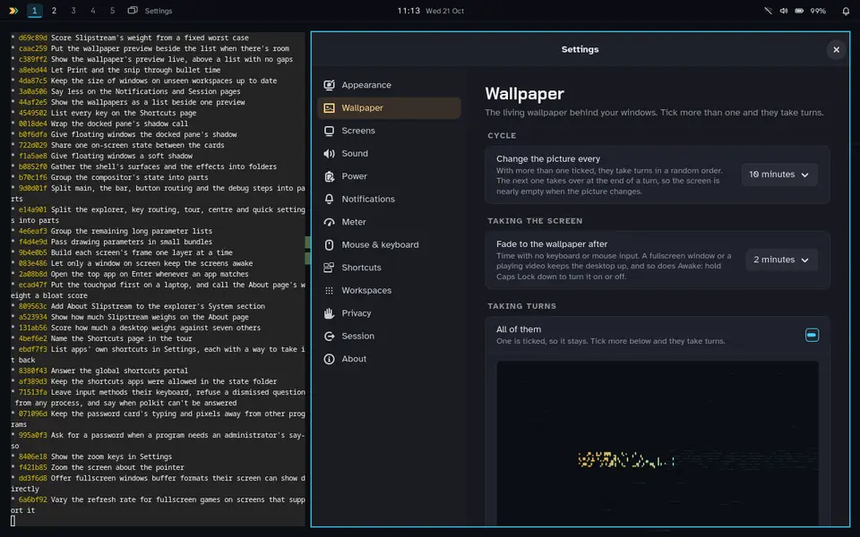

**Bullet time.** One shortcut tips the whole desktop back, with every workspace laid out in front of you and a letter on each window, and everything slows to a quarter of its speed while you look. Press a letter to land on that window. On a touchpad, swipe up with three fingers.

- **Keys your hands already know.** Windows' keys from the start, or a Mac's or Omarchy's habits instead, and every hint on screen follows your choice. Give any app keys of its own in Settings.
- **Tiling that isn't all or nothing.** Hold Super+T and pick an arrangement - grid, centre, wide, spotlight - from pictures of your own windows, which move as you choose.
- **An explorer that answers.** Tap Super and type an app, a setting, a file, `15% of 80`, `5 km in miles` or `:fire`.
- **One window that stays in view.** Super+W docks the window you're in to the bar as a pane of glass, on every workspace.

**New to tiling? Take the tour.** Press Super+/, then Enter. Fourteen short lessons start from the keys your hands already know, say why before what to press, and play out on a miniature of your own desktop, never on your real windows.

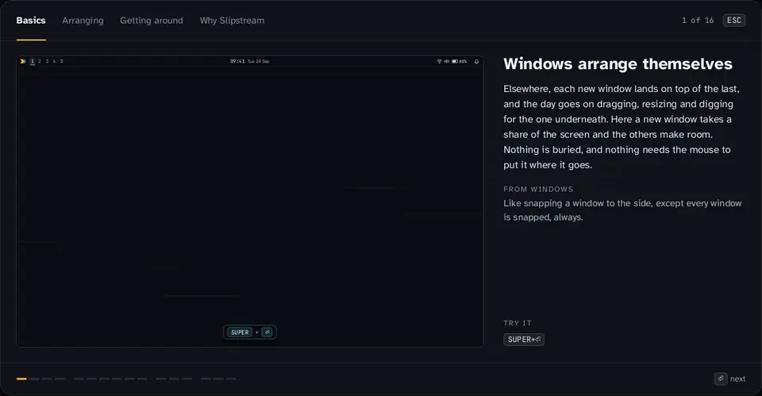

## Step away, and it comes alive

<table>
<tr>
<td align="center">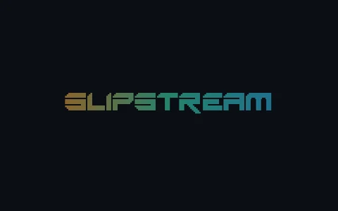<br><b>Galaxies</b><br><sub>Two galaxies collide, then the collision runs backwards.</sub></td>
<td align="center">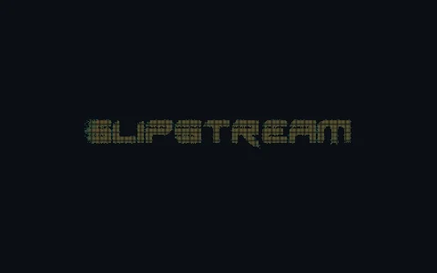<br><b>Physarum</b><br><sub>A slime mould creeps out over the screen in amber veins.</sub></td>
<td align="center">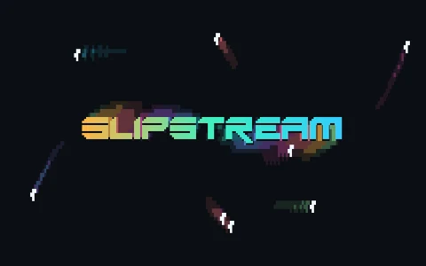<br><b>Life</b><br><sub>Conway's Game of Life, glowing and swirling to a beat.</sub></td>
</tr>
</table>

Leave your desk and your windows sink back into the wallpaper, which was running behind them all along. Touch any key and they rise back into place, exactly as you left them. Press F7 instead to take a screenshot of the wallpaper.

There are twenty, and most of them aren't animations at all: they're worked out live as you watch, so they never run quite the same way twice.

[**All twenty →**](guide/wallpapers.md)

## Make it yours

<table>
<tr>
<td width="50%" valign="top">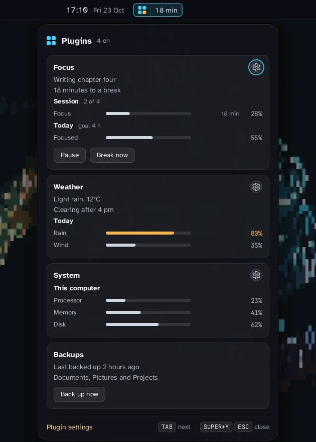</td>
<td width="50%" valign="top">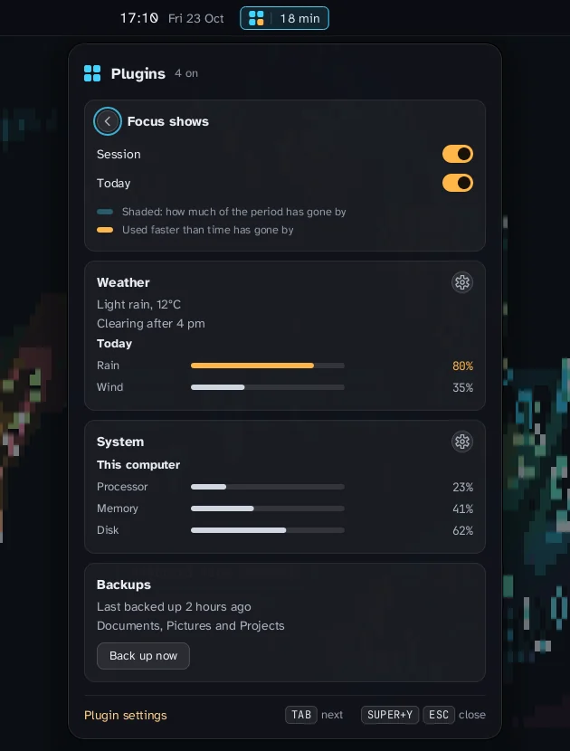</td>
</tr>
</table>

- **Plugins beside the clock.** Little apps, your own or other people's, add a card to a panel that drops from the bar (Super+Y), and can add a tile to quick settings, an answer in the explorer or an action on keys you choose. Anything that prints a line of JSON can be one. [Writing a plugin →](guide/plugins.md)
- **Nothing runs until you've looked.** Each plugin runs in a sandbox that reaches only what it lists, and Settings says in plain words what that is, and how safe, before you turn it on. If its files change later, it switches itself off until you've had another look and turned it back on.
- **One plugin comes with Slipstream.** Focus is a timer for spells of work that keeps an honest log of where they went. Switch it on in Settings, or read it as [a worked example](guide/plugins.md#focus-a-worked-example) of writing your own.
- **Your colours, everywhere.** Pick one of ten sets of three colours that go together, or any colour on a rainbow and the other two are chosen to match it. The whole desktop follows, Settings included.

## A workshop, not a slot machine

That's the whole idea: a desktop that stays out of your way while you work, lets you see what's going on without going to look, and keeps everything a keystroke away. Somewhere you sit down to make things, and get lost in the work rather than the machine.

## Get Slipstream

One command. It downloads the newest release, checks its published checksum and signature, and says what it will do before it writes anything:

```sh
sh -c "$(curl -fsSL https://raw.githubusercontent.com/peterwalker78/slipstream-desktop/main/install.sh)"
```

Then log out and choose **Slipstream** on the login screen. Tap Super for your apps, Super+Enter for a terminal, Super and the arrows to move around, Super+Tab for bullet time, and Super+/ for every key and the tour.

- **Check it.** Read [`install.sh`](install.sh) before you run it, or confirm a download was built here: `gh attestation verify slipstream-*.tar.gz --repo peterwalker78/slipstream-desktop`.
- **Two companion apps come with it,** Glimmerwood and Westering, as Flatpaks. The installer asks about each one first.

The same command can also try Slipstream first, or take it away again:

```sh
# Open it in a window on the desktop you're using now, installing nothing
sh -c "$(curl -fsSL https://raw.githubusercontent.com/peterwalker78/slipstream-desktop/main/install.sh)" -- --try

# Say what it would do, writing nothing
sh -c "$(curl -fsSL https://raw.githubusercontent.com/peterwalker78/slipstream-desktop/main/install.sh)" -- --check

# Remove exactly what it wrote
sh -c "$(curl -fsSL https://raw.githubusercontent.com/peterwalker78/slipstream-desktop/main/install.sh)" -- --uninstall
```

**You'll need** an x86_64 machine with Debian 13's libraries or newer (Ubuntu 24.04 and Linux Mint 22 aren't there yet), and graphics with working Mesa drivers. NVIDIA's driver hasn't been tried. Screen sharing needs xdg-desktop-portal-wlr 0.8 or newer.

**Status: release candidate (1.0.0-rc.1).** Every release is installed and started on Debian, Ubuntu, Fedora, Arch and openSUSE. Not yet: ARM machines, Ubuntu 24.04 and the distributions built on it, and packages in distributions' own repositories. The [changelog](CHANGELOG.md) says what's new in each release.

[**What you need, every other way to install it, which distributions it runs on, and building from source →**](guide/install.md)

## Everything else you'd expect

- **Snip, then watch it go.** Freeze the screen, drag out a region, and the part you chose shatters into rain glyphs that fly into the "saved" toast.
- **Windows are panes of glass.** Alt+Tab deals them as a deck receding into depth, and two tiles swapped with Super+Alt+arrows pass through each other.
- **A clipboard that decodes.** The last 25 things you copied, each unscrambling out of glowing characters into readable text as you reach it.
- **A battery that looks after you.** At 20% the wallpaper slows to half speed to save power; at 5% you get a minute's warning and then sleep, so your work survives.
- **Night light that follows the real sun,** warming the screen over half an hour at dusk rather than all at once.
- **Games and virtual machines behave.** They can hold the mouse and every key, and one shortcut always takes it back.
- **Light, for a desktop that looks like this.** Settings → About shows its Featherweight score: how light Slipstream is in real use beside other desktops, each one measured the same way.
- **The Linux tools you already have keep working.** Screenshot and recording tools like `grim` and `wf-recorder`, idle tools, colour-temperature tools - and nothing records your screen without asking you first, by name.

[**The full list →**](guide/features.md) · [**Every key →**](guide/keys.md)

## What we won't do

- No telemetry, ever. What you do on your computer stays on your computer.
- Nothing in Slipstream is built to keep you looking at it for longer than you meant to.
- No AI features, ever.
- Keybindings never take keys that input methods, screen readers, games or apps rely on.
- Every effect has a reduced-motion version, switched live from Settings.

## Questions

**Is it a whole desktop?** Yes: compositor, bar, notifications, lock screen, app explorer and a Settings app, with nothing to put together yourself. Settings are kept in plain text, in `~/.config/slipstream/settings.toml`.

**Is it built on another compositor?** No. It's a Wayland compositor of its own, written in Rust with the [Smithay](https://github.com/Smithay/smithay) library.

**Will it change the desktop I have?** No. It's added to the login screen beside it, and uninstalling removes exactly what the installer wrote.

**Will my apps run?** Wayland apps, X11 apps through XWayland, Flatpaks and games all do. Screenshot and recording tools like `grim` and `wf-recorder` keep working too.

**Does it phone home?** No. There's no telemetry, and it never checks for updates by itself.

**What if I do use an AI agent?** Slipstream will never put AI in front of you. But bring an agent of your own and you'll find it a great desktop to run one on: log out and an agent that can work in the background keeps going, then it's back in its window when you log in, attached and still working. That's what you'd usually want a terminal multiplexer for, without the multiplexer, in the terminal you already like. Your agent's sessions come back with your layout, right where you left them; a plugin beside the clock can show your plan's limits at a glance; a notification takes you straight to the terminal that sent it; and once the desktop has faded, the wallpaper shows which of your agents are still working. You don't need a new operating system for it: Slipstream installs on the distribution you already have. [**Keeping an agent working while you're logged out →**](guide/help.md#keeping-an-ai-agent-working-while-youre-logged-out)

**What doesn't work yet?** ARM machines, Ubuntu 24.04 and the distributions built on it, and screen sharing where xdg-desktop-portal-wlr is older than 0.8. NVIDIA's driver hasn't been tried. If something else doesn't work, [say so in an issue](https://github.com/peterwalker78/slipstream-desktop/issues).

## Companions

<table>
<tr>
<td width="50%" valign="top"><a href="https://github.com/peterwalker78/glimmerwood">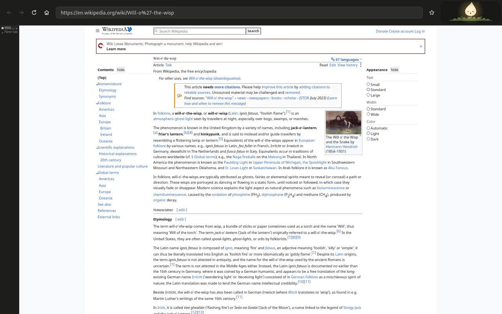</a><br><b><a href="https://github.com/peterwalker78/glimmerwood">Glimmerwood</a></b>, a quiet, lightweight browser. Its wisp, a small flame in the toolbar, brightens when you read, learn or make something, and grows sleepy in an endless feed. It never blocks or nags.</td>
<td width="50%" valign="top"><a href="https://github.com/peterwalker78/westering">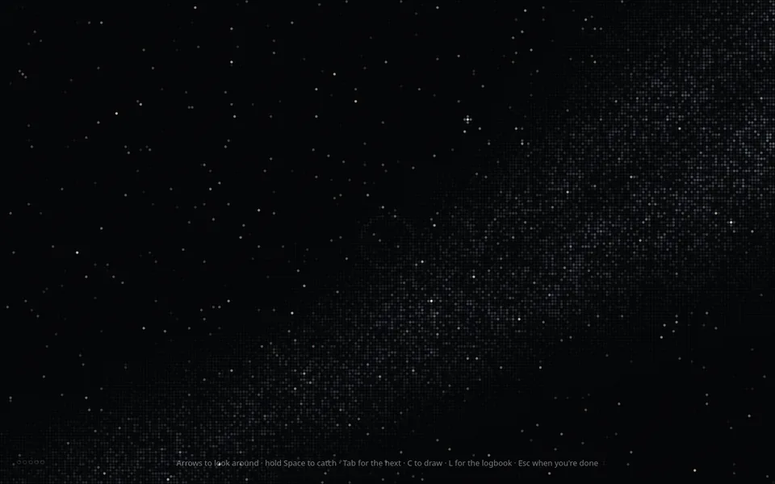</a><br><b><a href="https://github.com/peterwalker78/westering">Westering</a></b>, for the end of the day: a few quiet minutes under tonight's real sky, drawn in the same fine dots as the wallpapers, to set down what's on your mind. It has no network access at all.</td>
</tr>
</table>

Both are projects of their own that run on any Linux desktop. The installer adds them as Flatpaks; Super+B opens a new window of whichever browser you've made your default.

## Help and detail

| | |
|---|---|
| [**Installing**](guide/install.md) | what you need, every install route, which distributions, updating, uninstalling, building from source |
| [**Every key**](guide/keys.md) | the whole table - Super+/ shows it in the desktop too |
| [**Help**](guide/help.md) | when something goes wrong, a program asking to record your screen, plugins beside the clock, apps that come with your desktop, bringing an AI agent's session back, keeping one working while you're logged out, and seeing one at work from across the room |
| [**The living wallpapers**](guide/wallpapers.md) | all twenty, and how they behave |
| [**Everything a desktop needs**](guide/features.md) | the full feature list |
| [**Working on Slipstream**](guide/development.md) | the workspace, and running it nested |

AI coding tools are used in writing Slipstream's code. Every change is built and tested in CI.

## Licence

GPL-3.0-or-later. See [`LICENSE`](LICENSE). Parts of the compositor started from Smithay's `smallvil` example (MIT). The code rain is built from xscreensaver's GLMatrix. The fonts are under the SIL Open Font Licence; their licences are in `assets/fonts`.
